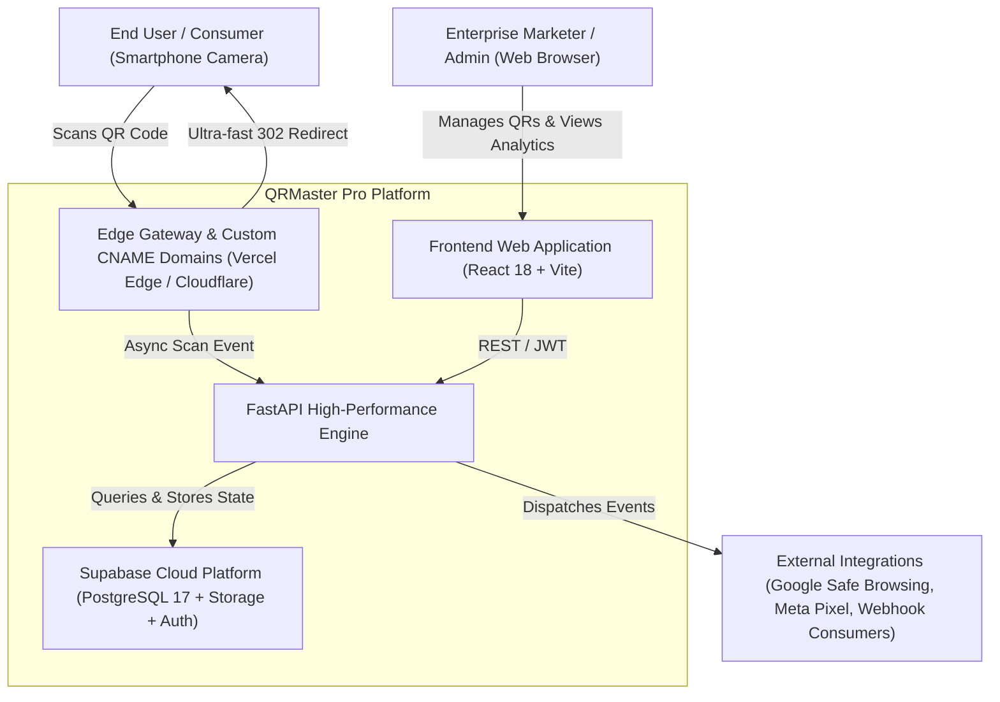
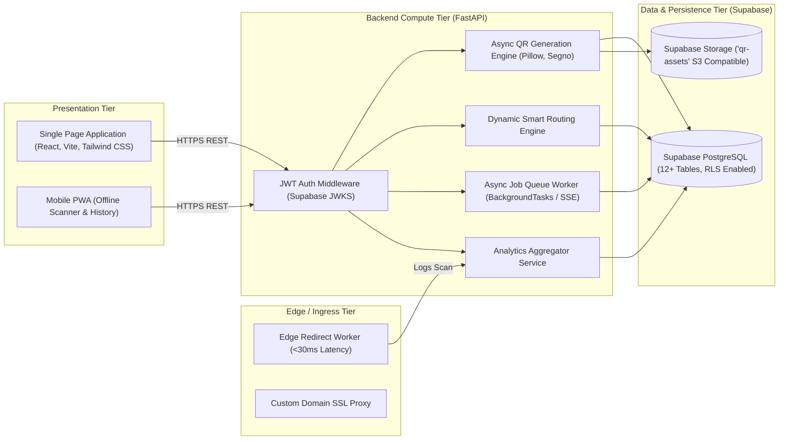

# QRMaster Pro — Long-Term Product Vision & Strategic Architecture

**Document Version:** 1.0.0  
**Status:** Approved Strategic Vision Document  
**Author:** REI Chief AI Systems Architect & CDO  
**Planning Horizon:** 6 to 18 Months  

---

## 1. Executive Vision Statement

> **"To establish QRMaster Pro as the most reliable, privacy-first, visually exceptional physical-to-digital intelligence platform for businesses, creators, and enterprise operations worldwide."**

QRMaster Pro will bridge the physical and digital worlds by transforming static square codes into **dynamic, branded, trackable interactive experiences**.

---

## 2. Target Customer Personas & Market Segments

```
  ┌────────────────────────────────────────────────────────────────────────┐
  │                        TARGET CUSTOMER PERSONAS                        │
  ├──────────────────┬──────────────────┬──────────────────┬───────────────┤
  │   1. The Brand   │ 2. The Restaurant│  3. The Event &  │  4. The B2B   │
  │     Marketer     │    & Retailer    │   Conference Org │  Supply Chain │
  ├──────────────────┼──────────────────┼──────────────────┼───────────────┤
  │ Needs:           │ Needs:           │ Needs:           │ Needs:        │
  │ • Branded frames │ • Touchless menu │ • Dynamic RSVP   │ • Bulk batch  │
  │ • Retargeting    │ • Google review  │ • Schedule change│ • Webhooks    │
  │ • Split A/B tests│ • Table numbers  │ • Badge check-in │ • High uptime │
  │ • Multi-format   │ • Simple edits   │ • Live stats     │ • Scoped API  │
  └──────────────────┴──────────────────┴──────────────────┴───────────────┘
```

---

## 3. Target System Architecture (C4 Model)

### 3.1 C4 Level 1: System Context Diagram



### 3.2 C4 Level 2: Container Diagram



---

## 4. Monetization & Packaging Strategy

| Tier | Price | Target Audience | Key Feature Boundaries |
| :--- | :--- | :--- | :--- |
| **Community / Self-Host** | **Free / Open Source** | Developers & Hobbyists | Unlimited static QRs, 5 dynamic QRs, 100 scans/mo, community support |
| **Starter** | **$9 / month** | Freelancers & Creators | 25 dynamic QRs, 10,000 scans/mo, custom colors & logos, 1 vCard Plus page |
| **Pro Marketer** | **$29 / month** | SMBs & Growth Agencies | 250 dynamic QRs, unlimited scans, branded CTA frames, OS routing, retargeting pixels, bulk upload (1,000 codes) |
| **Enterprise** | **$99+ / month** | Corporations & Brands | Unlimited dynamic QRs, custom CNAME domains (`qr.brand.com`), team workspaces, SSO, 99.99% SLA, dedicated API webhooks |

---

## 5. Strategic 12-Month Product Milestones

### Q1: Performance, Polish & Brand Engine (v1.1)
- Initial bundle cut from 1.28MB to 165KB via route code-splitting.
- Independent eye/pupil styling and 4 branded CTA frames ("Scan Me").
- Dynamic OS smart routing (iOS vs Android app store redirection).
- Async bulk generation with live SSE progress updates.

### Q2: Interactive Micro-Landing Pages (v1.2)
- Built-in no-code mobile landing page builder:
  - Digital Business Card (vCard Plus with 1-tap "Save to Contacts").
  - Restaurant Menu with photo items and allergen badges.
  - Multi-Link Bio page.
- Retargeting pixel script injection (Meta Pixel, Google Tag Manager).

### Q3: Multi-Tenant SaaS & Custom Domains (v2.0)
- Supabase Auth integration (Email/Password, Magic Link, Google OAuth).
- Multi-user team workspaces with Role-Based Access Control (RBAC).
- Custom CNAME branded domains (`qr.mycompany.com`).
- GDPR-compliant IP anonymization and automated 90-day retention lifecycles.

### Q4: Developer Ecosystem & Enterprise Webhooks (v2.5)
- Public developer API with scoped API keys.
- Real-time Webhooks on scan events for supply chain and CRM automation.
- Geo-fenced dynamic routing and time-of-day scheduled redirects.
